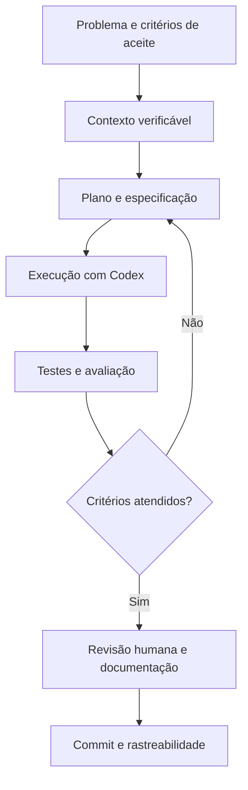

# 00 — Roadmap de desenvolvimento assistido por IA

[← Índice](README.md) · [Próximo: paradigmas →](01-paradigmas-e-metodologias.md)

## Objetivo e pré-requisitos

Aprender a **delegar com critérios verificáveis**, e não apenas gerar código. Pressupõe conhecimento básico de Git, VS Code, terminal Linux e Python. Para Ciência de Dados, são desejáveis pandas/Polars, SQL, métricas estatísticas e noções de validação experimental.

## Mapa conceitual



## Trilha progressiva

| Etapa | Competência | Exercício aplicado | Critério de conclusão |
|---|---|---|---|
| 1. Fundamentos | Diferenciar modelo, agente, contexto e ferramentas | Pedir ao Codex para explicar estrutura de um projeto Python | Reconhece limites e não confunde texto gerado com evidência |
| 2. Git e ambiente | Isolar ambientes e mudanças | Criar branch de tarefa; verificar `python --version` e `git status` | Alterações auditáveis, ambiente identificado |
| 3. Prompt e especificação | Formular objetivo, entradas, restrições e aceite | Especificar leitor de Parquet sem implementação | Especificação contém exemplos e casos de erro |
| 4. Planejamento | Decompor mudanças e dependências | Solicitar plano antes de alterar ETL | Plano revisável sem tocar dados originais |
| 5. Testes | Derivar testes de contratos e invariantes | Testar duplicatas, nulos, schema e idempotência | Testes reproduzíveis falham corretamente antes da correção |
| 6. Rules e skills | Separar invariantes de processos repetíveis | Usar `rules/data-quality.md` e skill `dataset-profiling` | Saída segue checklist, com evidências |
| 7. MCP | Distinguir acesso e autorização | Ativar Docs MCP e verificar ferramentas expostas | Conexão confirmada sem compartilhar segredos |
| 8. Modelagem | Avaliar pipelines sem vazamento | Group split por `case_id`, baseline e métrica | Transformações ajustadas só no treino |
| 9. Agentes avançados | Revisar chamadas, efeitos colaterais e custos | Refatorar pipeline em pequenas etapas | Diff e testes revisados a cada etapa |
| 10. Governança | Versionar decisões e artefatos | Registrar ADR curto e resultados do experimento | Um terceiro consegue reproduzir o resultado |

## O que dominar primeiro

1. **Especificação executável**: declarar interface, tipos, exemplos, erros esperados, limites e testes.
2. **Contexto operacional**: fornecer arquivos e diretórios relevantes, versões, logs mínimos, sem despejar dados sensíveis.
3. **Validação independente**: executar `pytest`, inspeções de schema e experimentos controlados.
4. **Higiene estatística**: separar grupos antes de transformar e ajustar modelos; definir baseline.
5. **Supervisão humana**: aprovar leitura de fontes sensíveis, instalações, acesso à rede e alterações destrutivas.

## Laboratório A — Pipeline analítico seguro

Crie uma branch e confira os arquivos existentes:

```bash
cd /home/thiagoney/GitHub/data-science-ai-toolkit
git switch -c docs/ai-development-guide
python scripts/validate_repository.py
git status --short
```

Prompt de prática (sem modificar dados de origem):

> Examine a estrutura do projeto. Proponha, sem editar arquivos, um pipeline que leia um dataset Parquet, valide `case_id` e métricas numéricas, gere um relatório em pasta de saída e inclua testes para schemas inesperados. Liste suposições e critérios de aceite.

Após aprovar o plano, solicite implementação em escopo limitado, revisão de diff e execução de testes. Não aceite métricas inventadas como comprovação.

## Laboratório B — Surrogate modeling científico

Considere simulações CFD com múltiplos tempos por caso. Defina uma tarefa `inputs + time -> drag_coefficient`. Solicite ao agente: particionamento **por caso**, baseline físico/estatístico, teste de não vazamento, métricas por caso, histogramas de resíduos e um arquivo de configuração de experimento. Não confunda interpolação temporal dentro de casos vistos com generalização para novos casos.

## Autoavaliação

- Sei explicar quais arquivos uma tarefa autoriza o agente a editar?
- Consigo inspecionar as ferramentas MCP conectadas e seus privilégios?
- Distingo validação de código, validação estatística e validação física?
- Posso reconstruir uma execução a partir de commit, dependências, seeds e dados versionados?

**Saída esperada:** um pequeno PR com testes, relatório de validação e descrição das limitações.
