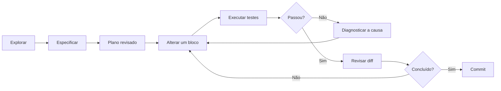

# 01 — Paradigmas e metodologias

[← Índice](README.md) · [← Roadmap](00-roadmap.md) · [Próximo: arquitetura →](02-arquitetura-e-ferramental.md)

## Comparação dos paradigmas

| Método | Quando usar | Vantagem | Principal risco | Controle recomendado |
|---|---|---|---|---|
| **Vibe Coding** | Prototipação descartável, UI exploratória | Iteração rápida | Código sem contrato, fragilidade e dependências ocultas | Sandbox, escopo curto e refatoração posterior |
| **Spec-to-Code** | Pipelines, serviços e contratos de dados | Critérios explícitos e revisão objetiva | Especificação incompleta | Exemplos positivos/negativos, contratos e aceite |
| **Plan-first / Plan Mode** | Refatorações, várias pastas e mudanças arquiteturais | Detecta dependências antes da edição | Plano grande e desatualizado | Marcos pequenos e checkpoints |
| **Agentic loop** | Implementação com inspeção e testes | Feedback operacional | Ciclos improdutivos, ações fora de escopo | Limites de ferramentas, tentativas e custo |
| **Grill Me** | Requisitos ambíguos | Expõe pressupostos | Perguntas sem prioridade | Perguntas bloqueantes, depois assumir e registrar |
| **TDD assistido por IA** | Funções críticas, parsers, ETL e cálculos | Evidência incremental | Testes que reproduzem bugs do código | Derivar casos da especificação, não da implementação |

*Vibe Coding* é um rótulo informal, não uma garantia de engenharia. *Grill Me* designa uma técnica de elicitação rigorosa, não um comando universal do Codex.

## 1. Vibe Coding com limites

Use para explorar representações gráficas ou provas de conceito, **não** como método final para pipelines produtivos ou conclusões científicas. Peça uma demonstração isolada, registre quais suposições foram feitas e converta o protótipo em contrato, testes e revisão antes de integrá-lo.

**Prompt:**

> Crie uma prova de conceito para visualizar a distribuição de Cd por simulação. Trabalhe somente com dados sintéticos. Não instale pacotes sem autorização; liste as lacunas para uma implementação confiável.

## 2. Spec-to-Code

Formalize a tarefa como entrada, saída, precondições, invariantes e testes:

```text
Goal: Validate a Parquet catalog of CFD simulations.
Inputs: parquet_path, expected_columns, output_directory.
Invariants: unique case_id; non-null case_id; no writes to input file.
Outputs: machine-readable validation report and nonzero exit on error.
Acceptance: unit tests for empty dataset, missing columns, duplicates.
Constraints: no network, no new dependencies without approval.
```

Sequência prática: **especificar → revisar contrato → criar testes → implementar → executar → revisar diff**.

## 3. Planejar antes de agir

No Codex, peça explicitamente um plano e a proibição de edições até revisão; a disponibilidade de uma opção visual de planejamento depende da versão do cliente. O comando `/plan` pode existir em determinados ambientes, mas a instrução textual é portátil.

**Prompt:**

> Modo planejamento: examine `src/`, `tests/` e `AGENTS.md`. Não edite arquivos. Gere um plano com arquivos impactados, riscos, testes, estratégia de rollback e decisões que exigem minha aprovação.



## 4. Agentic loops

Um loop de agente alterna **observação, decisão, ação e feedback**. Não é a mesma coisa que um script determinístico; ferramentas podem gerar efeitos colaterais. Estabeleça orçamento de chamadas, escopo de arquivos, limites de tentativas e pontos de aprovação.

**Exemplo:** investigar erro de schema no ETL: ler erro → localizar teste de schema → propor mudança → executar teste unitário → comparar schema antes/depois → revisar.

**Evite:** permitir reexecução ilimitada, apagar datasets para “corrigir” um erro ou assumir que execução não verificada funcionou.

## 5. Grill Me / elicitação adversarial

Antes de uma implementação, peça perguntas que descubram requisitos contraditórios:

> Faça até 8 perguntas de alto impacto sobre origem dos dados, granularidade do split, unidade física, formato de saída, escala, custos e critérios de sucesso. Priorize riscos de decisões irreversíveis. Se não houver resposta, registre suposições para revisão — não implemente ainda.

Perguntas típicas: “o mesmo `case_id` pode aparecer em treino e teste?”, “os campos têm mesma malha?”, “qual unidade de temperatura?”, “os arquivos de origem são imutáveis?”.

## 6. TDD com IA: Red–Green–Refactor

1. Escreva contratos e casos-limite de forma independente do código.
2. Gere testes pequenos que falhem pelo comportamento ausente (**red**).
3. Implemente o mínimo (**green**).
4. Refatore mantendo testes e inspeção de regressão (**refactor**).
5. Revise se os testes realmente cobririam uma implementação incorreta.

Exemplo de teste de invariante:

```python
import pandas as pd


def test_catalog_has_unique_case_identifiers():
    # Verifica que um mesmo caso não é representado duas vezes no catálogo.
    catalog = pd.DataFrame({"case_id": ["c1", "c1"]})
    assert catalog["case_id"].is_unique is False
```

Esse exemplo ilustra a asserção da propriedade; em um projeto real, o teste deve chamar a **função de validação do produto** e verificar sua falha para dados duplicados, não somente testar o pandas.

## Critério de escolha

Para scripts de exploração efêmeros, prototipação com revisão é suficiente. Para pipelines de dados ou inferência, use **Spec-to-Code + TDD**. Para refatorações transversais, acrescente **plan-first**. Para estudos científicos, exija ainda **desenho experimental, separação rigorosa de dados e validação física**.
