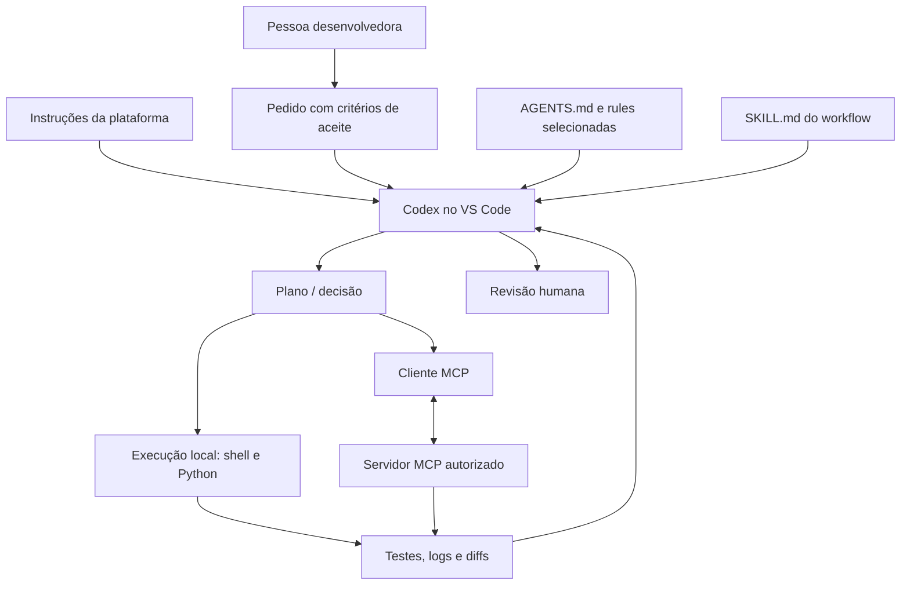
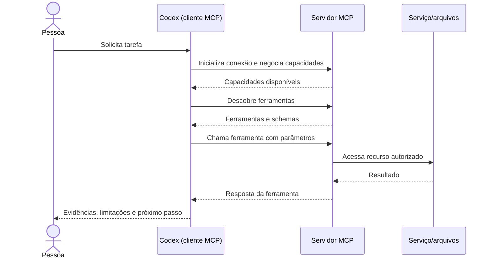

# 02 — Arquitetura e ferramental

[← Índice](README.md) · [← Paradigmas](01-paradigmas-e-metodologias.md) · [Próximo: configurações →](03-configuracoes-deste-projeto.md)

## Camadas de operação

| Camada | Responsabilidade | Exemplo no toolkit | O que **não** faz |
|---|---|---|---|
| **System / developer instructions** | Definir regras e limites de prioridade superior, geridos pela plataforma | Não versionadas neste repositório | Não são substituíveis por texto em `AGENTS.md` |
| **Prompt da tarefa** | Especificar objetivo, entrada, restrições e aceite | Solicitação no chat | Não concede acesso técnico automaticamente |
| **AGENTS.md** | Instruções locais persistentes para o agente | `AGENTS.md` | Não é uma política imutável de execução |
| **Rules** | Convenções e invariantes por domínio | `rules/machine-learning.md` | Não são carregadas automaticamente só por estarem em `rules/` |
| **Skill** | Procedimento repetível e seus recursos | `.agents/skills/model-evaluation/SKILL.md` | Não disponibiliza ferramentas por si só |
| **MCP** | Protocolo para conectar cliente a servidores de ferramentas/contexto | `.codex/config.toml.example` | Não assegura confiabilidade nem autoriza ações fora de escopo |
| **Ambiente de execução** | Python, shell, Conda, GPU, rede, disco | Máquina local com Codex | Não equivale a MCP ou skill |

**Importante:** as configurações controlam comportamentos distintos. Nenhum arquivo do repositório tem autoridade para substituir instruções de maior prioridade, aprovações ou permissões do sistema.

## Arquitetura do fluxo



## Prompts de sistema versus instruções do repositório

O prompt de sistema é fornecido pelo ambiente hospedeiro. `AGENTS.md` é uma **instrução de projeto**, útil para padrões recorrentes (idioma, testes, segurança de dados). O desenvolvedor geralmente edita `AGENTS.md`, não as instruções de sistema. Use o chat para instruções pontuais e arquivos de regras para invariantes especializados.

## Rules: uso modular

O Codex reconhece instruções do repositório via `AGENTS.md`. Neste projeto, o arquivo principal manda ler regras aplicáveis em `rules/`; esses Markdown são um catálogo **manual**, não um mecanismo automático de glob patterns.

Exemplo de prompt:

> Leia `AGENTS.md`, `rules/python-standards.md`, `rules/data-engineering.md` e `rules/data-quality.md`. Antes de editar o pipeline, enumere invariantes e testes obrigatórios.

## Skills: instruções e recursos

Skills são pastas com um `SKILL.md` e opcionalmente scripts, referências e templates. O agente pode descobrir a skill pelo nome e pela descrição e então ler seu conteúdo para aplicar o processo.

```text
.agents/skills/
└── dataset-profiling/
    └── SKILL.md
```

Exemplo de acionamento explícito:

> Utilize a skill `dataset-profiling`. Analise somente o schema e estatísticas agregadas de `data/processed/catalog.parquet`, sem alterar a fonte. Entregue relatório e comandos usados.

## MCP — modelo cliente/servidor

MCP padroniza como clientes descobrem ferramentas e recursos de servidores. A implementação de um servidor define o que as ferramentas fazem e quais credenciais ou privilégios são necessários. O cliente e o ambiente continuam responsáveis por controles de acesso e aprovações.



### Transportes e configuração

- **Streamable HTTP** para MCP remoto, por exemplo OpenAI Docs MCP.
- **stdio** para processos locais que falam MCP em stdin/stdout.
- **Nem todo servidor é instalado por copiar um bloco de TOML**: para os locais, dependências, caminho, rede e credenciais precisam existir.

Em Codex, a CLI e a extensão compartilham configurações MCP. Exemplo de servidor remoto:

```toml
[mcp_servers.openaiDeveloperDocs]
url = "https://developers.openai.com/mcp"
```

CLI para consultar o estado:

```bash
codex mcp add openaiDeveloperDocs --url https://developers.openai.com/mcp
codex mcp list
```

Para segurança, prefira credenciais por ambiente ou autenticação suportada pelo servidor e **não** publique tokens no Git.

## Critério para escolher a camada

- Mudança de estilo transversal? **AGENTS.md**.
- Regra estável sobre isolamento de treino e teste? **Rule**.
- Procedimento de EDA com etapas e entregáveis? **Skill**.
- Consultar documentação oficial ou serviço externo? **MCP** (quando apropriado).
- Executar `pytest`, pandas ou o solver local? **Ferramenta local / shell**, sujeito às permissões.

## Referências

- [Codex e MCP](https://developers.openai.com/codex/mcp)
- [Documentação MCP](https://modelcontextprotocol.io/)
- [Agent Skills](https://agentskills.io/)
- [OpenAI Docs MCP](https://developers.openai.com/learn/docs-mcp)
