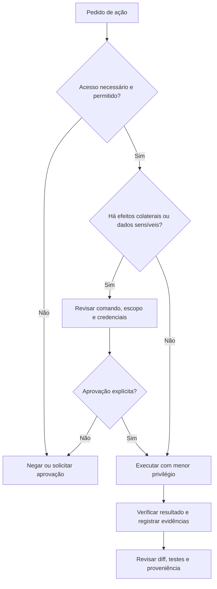

# 04 — Boas práticas e governança

[← Índice](README.md) · [← Configurações](03-configuracoes-deste-projeto.md)

## Governança orientada a evidências

O agente é um executor assistido: **não** é autoridade científica, revisor de segurança ou substituto do responsável pelos dados. Configure limites explícitos, preserve trilha de auditoria e diferencie observação de hipótese.

## Gerenciamento de contexto

1. **Menor contexto relevante:** informe objetivo, arquivos e erros pertinentes; evite transcrever um repositório inteiro.
2. **Fontes canônicas:** código e documentação versionados valem mais do que lembranças de chat; valide suposições no ambiente.
3. **Memória operacional:** mantenha decisões em `AGENTS.md`, ADRs ou documentação, sem inflar instruções globais.
4. **Progressão:** leitura de schema → amostra mínima permitida → implementação → testes → revisão.
5. **Reancoragem:** após longas sessões, peça resumo de decisões, arquivos alterados e comandos efetivamente executados.

**Prompt recomendado:**

> Antes de responder, enumere fatos verificados em arquivos ou ferramentas, hipóteses ainda não testadas e perguntas bloqueantes. Não invente saídas de comandos, versões nem referências.

## Prevenção de alucinações

| Risco | Exemplo | Contramedida |
|---|---|---|
| API fictícia | Método inexistente da biblioteca | Consultar documentação e testar import/chamada |
| Métrica inventada | “RMSE = 0.02” sem treino | Executar experimento e anexar artefato |
| Citação inventada | Artigo sem DOI verificável | Registrar URL/DOI verificável e data de consulta |
| Generalização falsa | Avaliar janelas de caso visto como caso novo | Split por `case_id` ou desenho adequado |
| Execução imaginada | “Tests passed” sem log | Exigir comando, status de saída e saída relevante |

## Segurança de ferramentas MCP e shell



### Riscos específicos

- **Prompt injection:** README externo, página web e resposta MCP são **dados não confiáveis**, não instruções privilegiadas.
- **Exfiltração:** não inclua `.env`, tokens, credenciais, chaves SSH ou datasets privados em prompts, URLs ou commits.
- **Efeito colateral:** ferramentas podem escrever, apagar, executar e publicar; revise chamadas e preserve a opção de rollback.
- **Supply chain:** versões não fixadas, pacotes desconhecidos e `npx -y` podem instalar/executar código externo; verifique procedência e fixe versões após validação.
- **Scopes:** separe servidores somente leitura de servidores com permissão de escrita; permita diretórios mínimos.

## Testes para Data Science

| Dimensão | Controle mínimo |
|---|---|
| Código | `pytest`, type checks, lint, tratamento de erros |
| Dados | schema, valores nulos, duplicatas, ranges, proveniência |
| Estatística | baseline, split adequado, métricas e intervalo de confiança quando pertinente |
| Científica | unidades, conservação, tolerâncias numéricas, plausibilidade física |
| Reprodução | dependências, seeds, versão dos dados, commit, hardware relevante |
| Segurança | análise do diff, arquivos de saída, segredos e permissões |

### Checklist anti-leakage

- Split definido **antes** de fit de scalers/imputers/seletores de features.
- Simulações relacionadas agrupadas em uma única partição quando a meta for generalização para novos casos.
- Teste final não usado para seleção de modelos ou hiperparâmetros.
- Resultados agregados e por subgrupo reportados; nenhum dado de teste reaproveitado na engenharia de features.

## Documentação contínua

Para cada modificação importante, registre:

```markdown
# Decision: <short-title>

- Date: YYYY-MM-DD
- Context: Why is this decision necessary?
- Decision: What changes and what remains unchanged?
- Alternatives: Which options were rejected and why?
- Validation: Commands, artifacts and acceptance criteria.
- Risks: Known limitations and rollback procedure.
```

O modelo acima é um template de registro de decisão; substitua placeholders antes de publicar.

## Protocolo de revisão de PR

1. Conferir diff por escopo e verificar se `data/raw/` permaneceu intacto.
2. Identificar dependências e ações de rede adicionadas.
3. Executar `python scripts/validate_repository.py` e os testes aplicáveis.
4. Verificar se números relatados estão ligados a artefatos reproduzíveis.
5. Atualizar README, documentação e decisões quando o comportamento mudar.
6. Fazer commit explicativo e revisão antes de merge.

```bash
cd /home/thiagoney/GitHub/data-science-ai-toolkit
python scripts/validate_repository.py
git diff --check
git status --short
```

## Política de divulgação de resultados

- **Executado e verificado:** incluir comando e evidência.
- **Inspecionado estaticamente:** informar que testes não foram executados.
- **Proposto:** tratar como hipótese/implementação pendente.
- **Não disponível:** declarar limitação e não inferir resultado.

## Referências

- [OpenAI Codex](https://developers.openai.com/codex/)
- [MCP — arquitetura e segurança](https://modelcontextprotocol.io/)
- [GitHub MCP](https://github.com/github/github-mcp-server)
